<p align="center">
  
  <br>
  <sub>Enhances the reliability of managing app lifecycles across iOS and Android, ensuring consistent foreground and background state detection.</sub>
</p>

<p align="center">
  <b>React-Native App Lifecycle</b> bridges the gap in React Native's built-in <a href="https://reactnative.dev/docs/appstate">AppState</a> on Android. By utilizing AndroidX <a href="https://developer.android.com/reference/androidx/lifecycle/ProcessLifecycleOwner">ProcessLifecycleOwner</a> for Android and falling back gracefully to native AppState on iOS, it guarantees that the <code>background</code> state is only dispatched when the entire application is truly in the background—eliminating false triggers when opening secondary activities like cameras, file pickers, or OAuth custom tabs.
</p>

<p align="center">
  <a href="LICENSE"></a>
  <a href="https://www.npmjs.com/package/react-native-applifecycle"></a>
  <a href="https://www.npmjs.com/package/react-native-applifecycle"></a>
  
  = 0.60">
  
  <a href="https://github.com/douglasjunior/react-native-applifecycle/pulls"></a>
</p>

<p align="center">
  <a href="#-quick-start"><b>Quick Start</b></a> ·
  <a href="#-why-react-native-app-lifecycle">Why</a> ·
  <a href="#-how-it-works">How It Works</a> ·
  <a href="#-requirements">Requirements</a> ·
  <a href="#-installation">Installation</a> ·
  <a href="#-usage">Usage</a> ·
  <a href="#-api-reference">API Reference</a> ·
  <a href="#-jest-mock">Jest Mock</a> ·
  <a href="#limitations">Limitations</a> ·
  <a href="#-contributing">Contributing</a>
</p>

---

## 🚀 Quick Start

```bash
# 1. Install dependency
yarn add react-native-applifecycle
# or: npm i -S react-native-applifecycle
```

```tsx
import React, { useEffect } from 'react';
import { View, Text } from 'react-native';
import { AppLifecycle, useAppLifecycle } from 'react-native-applifecycle';

export default function App() {
  // Option A: Convenient React Hook
  const currentLifecycle = useAppLifecycle();

  // Option B: Event Subscription
  useEffect(() => {
    const subscription = AppLifecycle.addEventListener('change', (state) => {
      console.log('App lifecycle transitioned to:', state);
    });

    return () => subscription.remove();
  }, []);

  return (
    <View style={{ flex: 1, justifyContent: 'center', alignItems: 'center' }}>
      <Text>Current Lifecycle: {currentLifecycle}</Text>
    </View>
  );
}
```

---

## 💡 Why React-Native App Lifecycle?

- 🎯 **Eliminates False Background Events on Android.** Opening a camera preview, an image picker, Google Play billing, biometric prompt, or an OAuth Custom Tab halts the main React Native Activity, causing React Native's built-in `AppState` to prematurely dispatch `background`. This library keeps your app in `active` until the entire application process is obscured.
- 🤖 **Powered by AndroidX `ProcessLifecycleOwner`.** Listens directly to the whole application process lifecycle rather than an isolated Activity lifecycle, ensuring architectural fidelity on Android.
- 🍏 **Seamless iOS Parity.** Automatically falls back to React Native's native `AppState` on iOS, which already treats application-level scenes correctly.
- 🪝 **First-Class React Hook.** Includes `useAppLifecycle()` out of the box so functional components can react to lifecycle changes with zero listener boilerplate.
- 🔄 **100% Drop-in AppState Compatibility.** Matches the `addEventListener()`, `currentState`, and `isAvailable` APIs of React Native's standard `AppState` for effortless migration.
- 🧪 **Built-in Jest Mocking.** Includes a dedicated mock helper (`react-native-applifecycle/jest/AppLifecycleMock`) ready for your automated unit and integration tests.
- 📦 **Zero Extra External JS Dependencies.** Ultra-lean codebase with native autolinking support for modern React Native applications.

---

## 🧠 How It Works

### The Core Problem with Standard `AppState`

React Native's built-in [`AppState`](https://reactnative.dev/docs/appstate) exhibits platform inconsistency when handling Android activities:

- **On iOS:** The `background` state accurately reflects that the entire application has been suspended or sent to the home screen / app switcher.
- **On Android:** React Native's `AppState` binds to the single `ReactActivity`. When another Activity within your application launches (such as a photo selector, payment flow, or secondary screen), the React Activity calls `onPause()`, which causes standard `AppState` to fire `background` even though the user is actively engaged inside your application.

```text
┌────────────────────────────────────────────────────────────────────────┐
│                        User Opens Camera Activity                      │
├────────────────────────────────┬───────────────────────────────────────┤
│ Standard RN AppState:          │ ⚠️ Reports "background" (Wrong!)     │
│ react-native-applifecycle:     │ ✅ Remains "active" (Correct!)        │
└────────────────────────────────┴───────────────────────────────────────┘
```

### State Comparison

| Scenario | Standard RN `AppState` (Android) | `react-native-applifecycle` (Android) | iOS Behavior |
|---|---|---|---|
| User is in the React Native screen | `active` | `active` | `active` |
| Secondary native Activity opens (Camera, Picker, In-App Webview) | `background` ⚠️ *(Premature)* | **`active`** ✅ | `active` |
| User presses Home or switches apps | `background` | **`background`** | `background` |
| User returns to the app from Home | `active` | **`active`** | `active` |
| Notification Center / App Switcher open | `inactive` (iOS only) | `active` (Android) / `inactive` (iOS) | `inactive` |

By using `react-native-applifecycle`, your background sync routines, timeout locks, session managers, and analytics only trigger when the user actually leaves your application.

---

## 📋 Requirements

| Platform / Tool | Supported Version |
|---|---|
| **React Native** | `>= 0.60.0` |
| **Android** | `minSdkVersion >= 21` (AndroidX Lifecycle supported) |

---

## 📦 Installation

### 1. Add JavaScript Package

Using Yarn:
```bash
yarn add react-native-applifecycle
```

Using npm:
```bash
npm i -S react-native-applifecycle
```

### 2. Native Linking

- **React Native 0.60+ (Autolinking):**
  Autolinking is configured automatically. No manual `react-native link` or Gradle modifications are required.
- **iOS:**
  No CocoaPods pod install needed specifically for this package since iOS directly utilizes React Native core's `AppState`.

---

## 💻 Usage

### 1. Using the React Hook: `useAppLifecycle()`

The simplest way to consume lifecycle status inside React functional components:

```tsx
import React from 'react';
import { View, Text } from 'react-native';
import { useAppLifecycle } from 'react-native-applifecycle';

export const StatusScreen = () => {
  const lifecycle = useAppLifecycle();

  return (
    <View style={{ padding: 20 }}>
      <Text>Application State: {lifecycle}</Text>
      {lifecycle === 'active' ? (
        <Text>App is in the foreground!</Text>
      ) : (
        <Text>App is running in the background.</Text>
      )}
    </View>
  );
};
```

### 2. Subscribing with `addEventListener()`

For imperative code, class components, or state stores (Zustand, Redux, MobX):

```tsx
import { useEffect } from 'react';
import { AppLifecycle } from 'react-native-applifecycle';

export const useAppLifecycleLogger = () => {
  useEffect(() => {
    const subscription = AppLifecycle.addEventListener('change', (nextState) => {
      console.log('App state changed to:', nextState);

      if (nextState === 'background') {
        // Safe to pause sensitive timers or persist state
        console.log('Entire app sent to background.');
      } else if (nextState === 'active') {
        // App has returned to the foreground
        console.log('App returned to active foreground.');
      }
    });

    return () => {
      subscription.remove();
    };
  }, []);
};
```

### 3. Synchronous State Inspection: `currentState`

You can inspect the current app state synchronously without waiting for an event:

```ts
import { AppLifecycle } from 'react-native-applifecycle';

function checkCurrentStatus() {
  const state = AppLifecycle.currentState;
  console.log('Current state:', state); // 'active' | 'background' | 'inactive' | 'unknown'
}
```

### 4. Availability Check: `isAvailable`

Verifies whether lifecycle observation is available on the current platform:

```ts
import { AppLifecycle } from 'react-native-applifecycle';

if (AppLifecycle.isAvailable) {
  console.log('AppLifecycle module is available and ready');
}
```

### 5. Multi-Activity Demonstration

For an interactive example showcasing the difference between `AppState` and `AppLifecycle` when opening a second Android Activity, check out the [Sample Project](Sample/App.tsx).

---

## 📚 API Reference

### Lifecycle States

| State | Platform | Description |
|---|---|---|
| `active` | Android & iOS | The application is running in the foreground. At least one activity is visible to the user. |
| `background` | Android & iOS | The application is running in the background. The user is either on the home screen or inside another app entirely. |
| `inactive` | iOS | The application is transitioning between foreground and background, or is in an inactive state such as viewing the multitasking app switcher, opening Notification Center, or handling an incoming call. |
| `unknown` | Android & iOS | Assigned when an unrecognised native lifecycle event is received. On Android the initial value is `AppState.currentState`. |

For additional background on iOS states, refer to the [React Native AppState documentation](https://reactnative.dev/docs/appstate#app-states).

---

### Events

| Event Type | Handler Signature | Description |
|---|---|---|
| `'change'` | `(state: AppStateStatus) => void` | Fired when the overall application transitions between `active`, `background`, or `inactive`. |
| `'memoryWarning'` | `() => void` | *(delegated to React Native `AppState`, all platforms; availability per RN docs)* Emitted when the operating system warns that memory is low. |
| `'focus'` | `() => void` | *(delegated to React Native `AppState`, all platforms; availability per RN docs)* Emitted when the app window gains focus. |
| `'blur'` | `() => void` | *(delegated to React Native `AppState`, all platforms; availability per RN docs)* Emitted when the app window loses focus. |

---

### Methods

#### `AppLifecycle.addEventListener()`

```ts
static addEventListener(
  type: AppStateEvent,
  listener: (state: AppStateStatus) => void,
): NativeEventSubscription;
```

Sets up an event listener that is invoked whenever the specified lifecycle event occurs. Returns a `NativeEventSubscription` object containing a `.remove()` method to cleanly unsubscribe.

---

### Properties

| Property | Type | Description |
|---|---|---|
| `AppLifecycle.currentState` | `AppStateStatus` | Synchronous getter returning the current lifecycle state (`'active'`, `'background'`, `'inactive'`, or `'unknown'`). |
| `AppLifecycle.isAvailable` | `boolean` | Synchronous getter indicating whether the lifecycle module is supported and available. |

---

### Hooks

#### `useAppLifecycle()`

```ts
function useAppLifecycle(): AppStateStatus;
```

A React hook that returns the current lifecycle status and automatically triggers a component re-render whenever the lifecycle state updates.

---

## 🧪 Jest Mock

To run unit tests without requiring native Android or iOS lifecycle bindings, add the provided mock to your `jest.setup.js` or directly inside your test file:

```javascript
jest.mock('react-native-applifecycle/dist/AppLifecycle', () =>
  require('react-native-applifecycle/jest/AppLifecycleMock'),
);
```

---

<a id="limitations"></a>

## ⚠ Limitations

> [!NOTE]
> In development mode, some lifecycle events may not trigger as expected due to how React Native manages backgrounding and hot reloading during Metro development sessions.
>
> For further details and discussion, see [Issue #13 (comment)](https://github.com/douglasjunior/react-native-applifecycle/issues/13#issuecomment-3065908934).

---

## 🤝 Contributing

Contributions, bug reports, and feature proposals are always welcome!

1. Fork the repository and create your topic branch (`git checkout -b feat/my-improvement`).
2. Verify that your TypeScript definitions compile without errors:
   ```bash
   yarn build
   ```
3. Commit your changes:
   ```bash
   git commit -m "Add support for new lifecycle trigger"
   ```
4. Push to your branch and open a descriptive [Pull Request](https://github.com/douglasjunior/react-native-applifecycle/pulls).

For questions and suggestions, please open an [issue](https://github.com/douglasjunior/react-native-applifecycle/issues).

### Support the Author

If this library helped solve your lifecycle issues, consider supporting the maintainer:

<p align="left">
  <a href="https://www.patreon.com/douglasjunior"></a>
  &nbsp;
  <a href="https://paypal.me/douglasnassif"></a>
</p>

---

## ⭐ Star History

<p align="center">
  <a href="https://star-history.com/#douglasjunior/react-native-applifecycle&Date">
    <picture>
      <source media="(prefers-color-scheme: dark)" srcset="https://api.star-history.com/svg?repos=douglasjunior/react-native-applifecycle&type=Date&theme=dark" />
      
    </picture>
  </a>
</p>

---

## 📄 License

```text
The MIT License (MIT)

Copyright (c) 2024 Douglas Nassif Roma Junior
```

See the full [license file](LICENSE).

---

## 🌐 Author & More Projects

<p align="center">
  <a href="https://douglasjunior.work">
    
  </a>
</p>

<p align="center">
  Discover more open-source libraries, creative animation engines, and developer tools at <a href="https://douglasjunior.work"><b>douglasjunior.work</b></a>.
</p>
